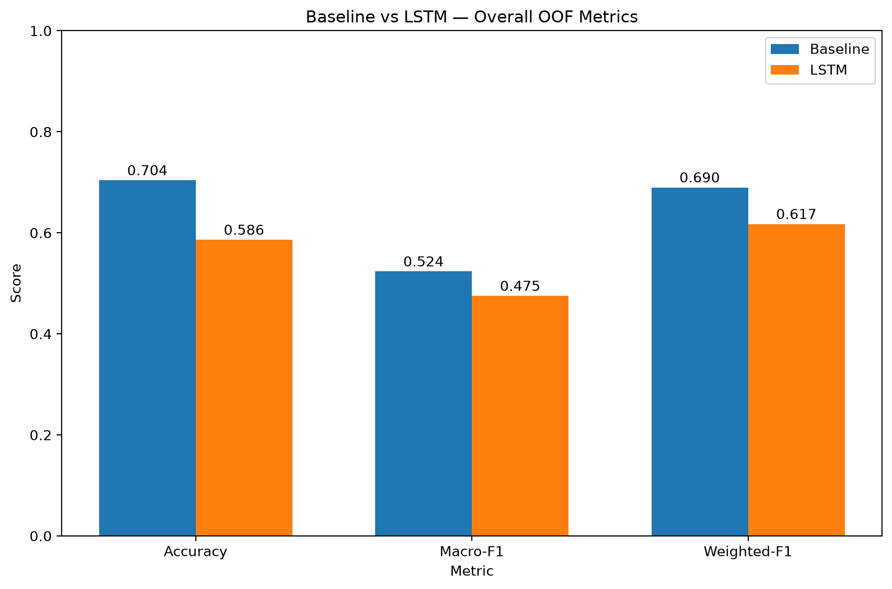
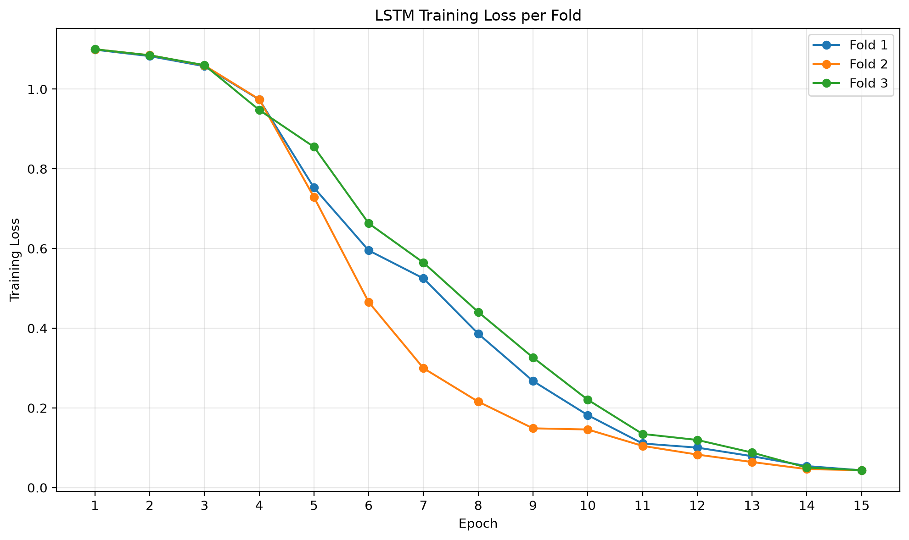
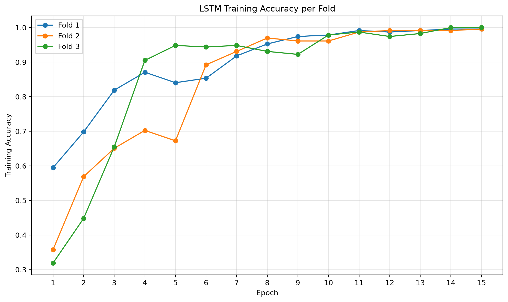
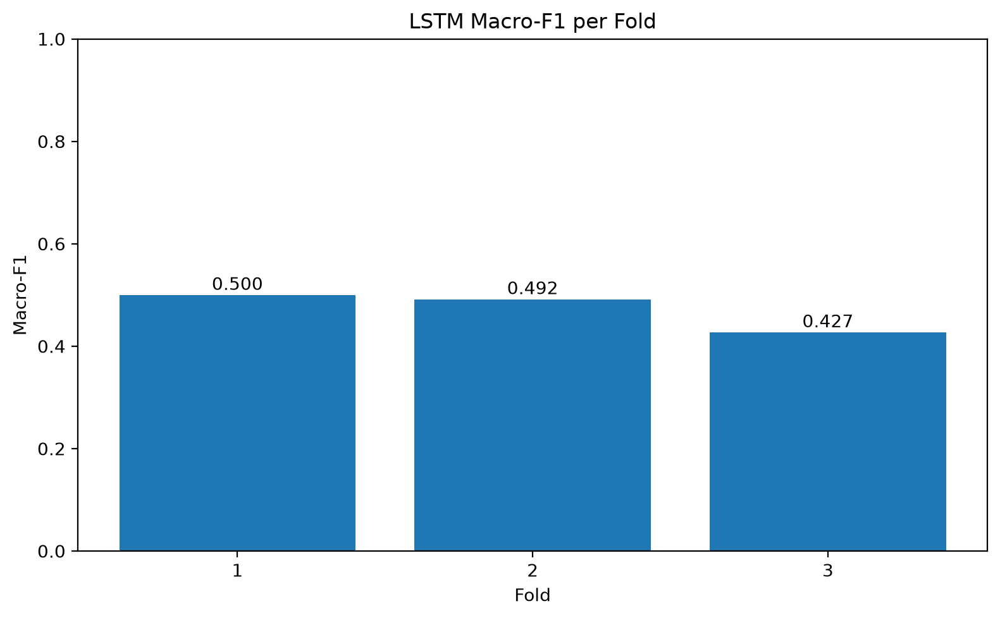
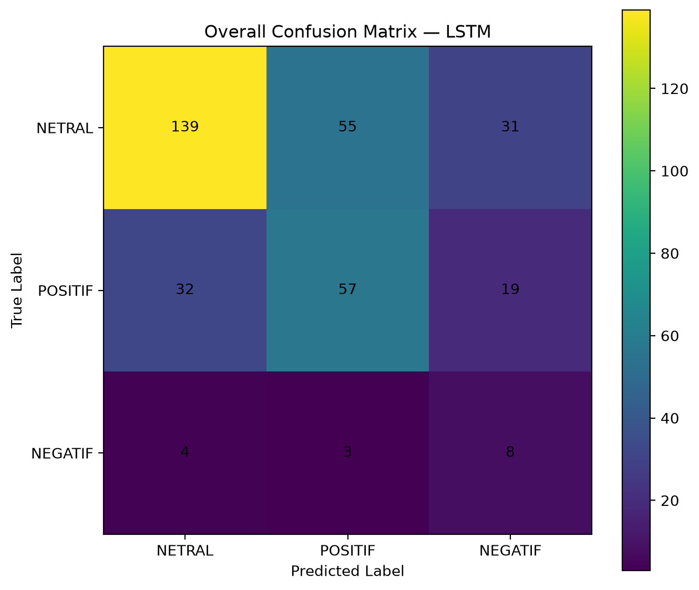
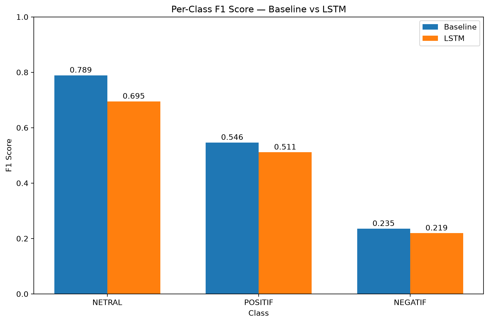
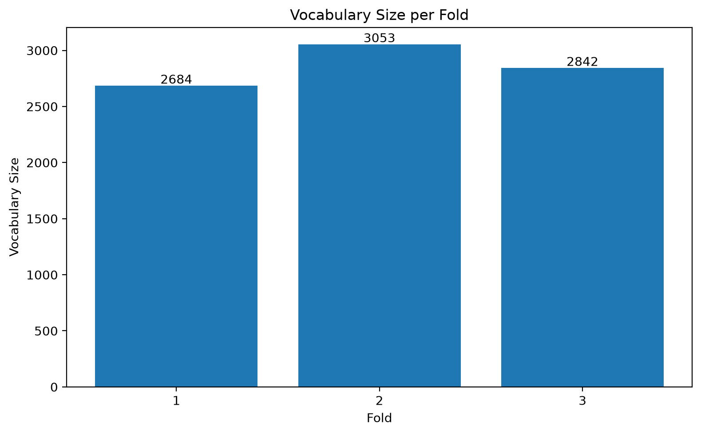
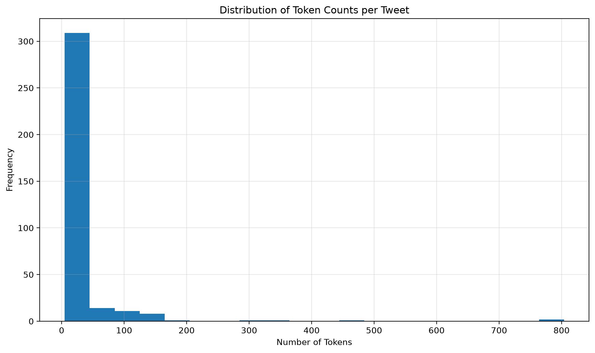
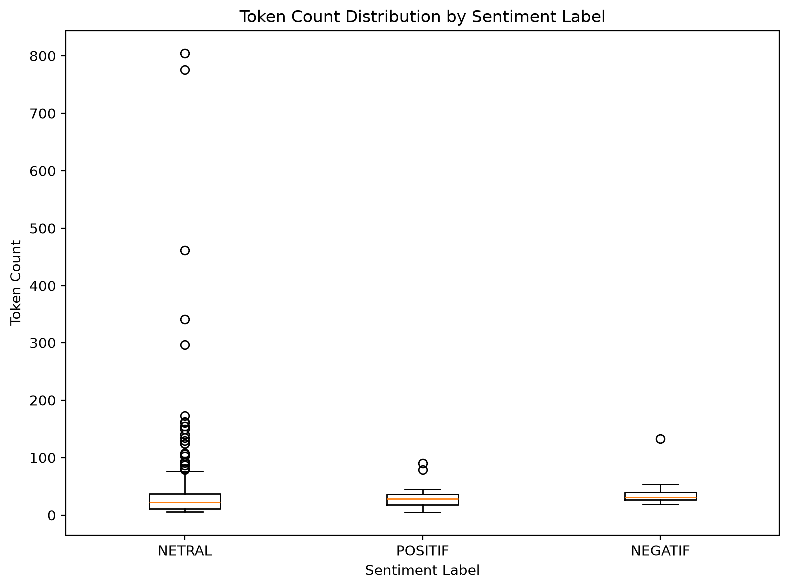

# LAPORAN EVALUASI AKHIR PEMODELAN SENTIMEN

**Penelitian:** Sentimen Penetapan Bencana Nasional
**Tahap:** Modeling Part20 — Final Evaluation Report
**Konfigurasi CV:** SGKF_3fold_seed123
**Tanggal laporan (UTC):** 2026-10-18T14:22:08.939790+00:00

> Laporan ini disusun menggunakan artefak OOF yang telah
> dikunci dari Part12, Part18, dan Part19. Tidak dilakukan
> pelatihan model baru atau pengubahan data.

## 1. Metodologi Evaluasi

Penelitian ini mengevaluasi 348 tweet yang dikelompokkan
menjadi 337 leakage group. Data terdiri atas tiga kasus,
yaitu Lombok 2018 (101 tweet), Palu 2018 (105 tweet),
dan Sumatera 2025 (142 tweet).

Evaluasi menggunakan Stratified Group K-Fold sebanyak
tiga fold, dengan seed 123. Setiap fold terdiri atas
232 tweet training dan 116 tweet validation.

Dua model dibandingkan pada keanggotaan validation fold
yang identik, yaitu TF-IDF dengan Logistic Regression
sebagai baseline dan LSTM_SMALL_V1.

Metrik utama penelitian adalah OOF Macro-F1, sedangkan
accuracy, precision, recall, dan weighted-F1 menjadi
metrik pendukung.

## 2. Hasil Evaluasi Keseluruhan

| model | accuracy | macro_precision | macro_recall | macro_f1 | weighted_f1 |
| --- | --- | --- | --- | --- | --- |
| baseline | 0.7040 | 0.7761 | 0.4943 | 0.5236 | 0.6898 |
| lstm | 0.5862 | 0.4760 | 0.5596 | 0.4751 | 0.6175 |

Baseline memperoleh accuracy 70.40% dan
Macro-F1 0.5236, sedangkan LSTM mencapai
accuracy 58.62% dan Macro-F1
0.4751.

Selisih Macro-F1 LSTM terhadap baseline adalah
-0.0484.
Baseline memiliki performa agregat yang lebih baik
menurut accuracy dan Macro-F1, sedangkan LSTM memiliki
Macro-Recall yang lebih tinggi.

*Gambar 1. Perbandingan metrik OOF baseline dan LSTM.*

## 3. Analisis Training LSTM

LSTM menggunakan arsitektur Embedding 32 dimensi,
LSTM 32 unit, dropout 0,30 dan softmax tiga kelas,
dengan total 168.419 parameter. Model dilatih 15 epoch
pada masing-masing fold.

Akurasi training akhir berturut-turut:
99.57%, 99.57%, 100.00%.
Loss training akhir berturut-turut:
0.0435, 0.0438, 0.0437.

Sebaliknya, accuracy OOF per fold LSTM berada sekitar
55%–62%. Perbedaan antara training dan validation
mengindikasikan overfitting. Karena validation tidak
dipakai selama fit(), laporan ini tidak menyatakan
epoch optimal atau validation-loss trajectory.

*Gambar 2. Perubahan training loss pada tiga fold.*

*Gambar 3. Perubahan training accuracy pada tiga fold.*

## 4. Evaluasi Macro-F1 dan Confusion Matrix LSTM

OOF Macro-F1 LSTM secara keseluruhan adalah
0.4751. Rata-rata nilai Macro-F1
ketiga validation fold dapat berbeda sedikit dari
Macro-F1 agregat OOF karena prosedur agregasi
metriknya berbeda.

*Gambar 4. Macro-F1 LSTM per fold.*

*Gambar 5. Confusion matrix agregat OOF model LSTM.*

Dari 348 tweet, LSTM mengklasifikasikan 204 tweet
secara benar dan 144 tweet secara salah.

## 5. Perbandingan Per Kelas

| model | label | precision | recall | f1 | support |
| --- | --- | --- | --- | --- | --- |
| baseline | NETRAL | 0.7510 | 0.8311 | 0.7890 | 225 |
| baseline | POSITIF | 0.5773 | 0.5185 | 0.5463 | 108 |
| baseline | NEGATIF | 1.0000 | 0.1333 | 0.2353 | 15 |
| lstm | NETRAL | 0.7943 | 0.6178 | 0.6950 | 225 |
| lstm | POSITIF | 0.4957 | 0.5278 | 0.5112 | 108 |
| lstm | NEGATIF | 0.1379 | 0.5333 | 0.2192 | 15 |

*Gambar 6. Perbandingan F1-score setiap kelas sentimen.*

Kelas NEGATIF berjumlah 15 tweet. Baseline mengenali
2 tweet NEGATIF
secara benar, sedangkan LSTM mengenali
8 tweet secara benar.

Namun, LSTM juga membuat
50 prediksi NEGATIF
yang sebenarnya berasal dari kelas lain. Hal tersebut
menyebabkan precision NEGATIF LSTM hanya
13.79% walaupun recall
mencapai 53.33%.

## 6. Perbandingan Berdasarkan Kasus Bencana

| model | case | rows | accuracy | macro_f1 | weighted_f1 |
| --- | --- | --- | --- | --- | --- |
| baseline | lombok_2018 | 101 | 0.7030 | 0.4406 | 0.6844 |
| baseline | palu_2018 | 105 | 0.6952 | 0.5481 | 0.6891 |
| baseline | sumatra_2025 | 142 | 0.7113 | 0.5377 | 0.6936 |
| lstm | lombok_2018 | 101 | 0.6139 | 0.4627 | 0.6325 |
| lstm | palu_2018 | 105 | 0.7048 | 0.5889 | 0.7165 |
| lstm | sumatra_2025 | 142 | 0.4789 | 0.4105 | 0.5248 |

LSTM memiliki Macro-F1 lebih tinggi daripada baseline
pada kasus Lombok 2018 dan Palu 2018, tetapi lebih
rendah pada Sumatera 2025. Perbedaan ini merupakan
temuan deskriptif dan belum membuktikan penyebab
perbedaan karakteristik tiap kasus.

## 7. Analisis Kesalahan Berpasangan

| category | count | percentage |
| --- | --- | --- |
| both_correct | 165 | 47.41% |
| baseline_only_correct | 80 | 22.99% |
| lstm_only_correct | 39 | 11.21% |
| both_wrong | 64 | 18.39% |

Kedua model benar pada 165 tweet.
Baseline saja benar pada
80 tweet,
sedangkan LSTM saja benar pada
39 tweet.

Kedua model sama-sama salah pada
64 tweet. Temuan ini menunjukkan
bahwa kedua model memiliki sebagian pola kesalahan
yang berbeda, tetapi tidak membuktikan bahwa kombinasi
keduanya akan meningkatkan performa.

## 8. Karakteristik Token dan Vocabulary

*Gambar 7. Ukuran vocabulary training-only per fold.*

Vocabulary LSTM berturut-turut berisi 2.684,
3.053, dan 2.842 entri, berada di bawah batas
maksimum 5.000. Tokenizer dibentuk dari training
fold masing-masing untuk mencegah kebocoran vocabulary
dari validation.

*Gambar 8. Distribusi jumlah token per tweet.*

Statistik panjang teks setelah preprocessing
(dihitung dengan pemisahan whitespace):
minimum 5, median
26.0, rata-rata
37.72, dan maksimum
804 token.

Sebanyak 14 dari 348 tweet
memiliki lebih dari 128 token sebelum vectorization.
Perhitungan ini bersifat deskriptif pada teks akhir,
bukan penghitungan indeks vocabulary aktif.

*Gambar 9. Distribusi panjang teks menurut sentimen.*

Boxplot membantu membandingkan panjang teks
NETRAL, POSITIF, dan NEGATIF. Perbedaan panjang
teks tidak dengan sendirinya membuktikan adanya
pengaruh kausal terhadap akurasi klasifikasi.

## 9. Keterbatasan Penelitian

1. **Ukuran dataset.** Evaluasi dilakukan terhadap
   348 tweet sehingga hasil belum dapat digeneralisasi
   untuk populasi diskusi media sosial yang lebih luas.
2. **Ketidakseimbangan kelas.** Distribusi sentimen
   adalah NETRAL 225, POSITIF 108, dan NEGATIF 15.
   Kelas NEGATIF hanya memiliki 5 validation tweet
   pada setiap fold.
3. **Tidak tersedia independent holdout test set.**
   Hasil dilaporkan sebagai out-of-fold evaluation,
   bukan estimasi kinerja pada sampel independen.
4. **Overfitting LSTM.** Training accuracy sangat
   tinggi, tetapi kinerja validation lebih rendah.
5. **Cakupan topik.** Dataset berasal dari tiga
   peristiwa bencana dengan periode dan konteks
   berbeda sehingga hasil bisa dipengaruhi
   karakteristik pembicaraan tiap peristiwa.
6. **Perbandingan bersifat deskriptif.** Tidak
   dilakukan klaim signifikansi statistik, kausalitas,
   atau keunggulan di luar konfigurasi yang diuji.
7. **Potensi bias pengumpulan dan anotasi data.**
   Distribusi tweet yang terkumpul dan proses
   penentuan label dapat memengaruhi hasil;
   evaluasi ini tidak membuktikan sampel representatif
   terhadap seluruh opini publik.

## 10. Kesimpulan Pemodelan

Pada dataset dan protokol evaluasi yang digunakan,
model TF-IDF + Logistic Regression memiliki kinerja
agregat lebih baik daripada LSTM_SMALL_V1 berdasarkan
accuracy dan OOF Macro-F1.

LSTM menghasilkan recall lebih tinggi pada kelas
NEGATIF, tetapi disertai banyak false positive.
Dengan demikian, penelitian ini memperlihatkan
trade-off antara sensitivitas kelas minoritas
dan precision klasifikasinya.

Model baseline menjadi hasil terbaik di antara dua
konfigurasi yang dievaluasi menurut metrik utama
OOF Macro-F1. Kesimpulan tersebut dibatasi pada
dataset, skema cross-validation, dan parameter
yang telah ditetapkan sebelumnya.

## 11. Provenance

- Baseline: Modeling Part12
- LSTM training: Modeling Part18
- Comparative evaluation: Modeling Part19
- Visualisasi: commit a613f00992acf1bc6e4a4f34240bc0a4d13a8139
- Final report: Modeling Part20
- Training ulang: tidak dilakukan
