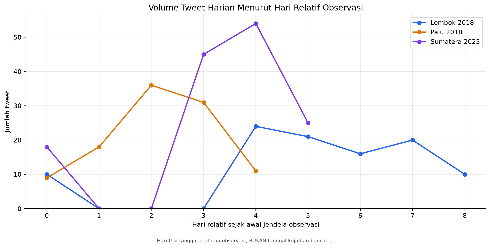

# DAFTAR GAMBAR HASIL PENELITIAN

**Fase:** 06_Result Part3

**Catatan:** Penomoran bersifat sementara dan akan disesuaikan dengan posisi gambar di BAB IV.

## A. Grafik Utama BAB IV

### Gambar 4.1

**Caption:** Perbandingan metrik evaluasi out-of-fold antara baseline TF-IDF + Logistic Regression dan LSTM.

**Bagian:** 4.3

**Catatan interpretasi:** Baseline unggul pada OOF Macro-F1. LSTM memiliki Macro-Recall lebih tinggi.

**Sumber:** `04_Modeling/outputs/lstm_visualizations/05_baseline_vs_lstm_overall_metrics.png`

### Gambar 4.2

**Caption:** Matriks kebingungan prediksi out-of-fold model LSTM pada tiga kelas sentimen.

**Bagian:** 4.3

**Catatan interpretasi:** Gunakan untuk membahas prediksi benar dan kesalahan antar kelas; bukan hasil independent test set.

**Sumber:** `04_Modeling/outputs/lstm_visualizations/04_confusion_matrix_lstm.png`

### Gambar 4.3

**Caption:** Perbandingan F1-score per kelas sentimen antara baseline dan LSTM berdasarkan prediksi OOF.

**Bagian:** 4.3

**Catatan interpretasi:** Kelas NEGATIF memiliki support hanya 15 tweet; interpretasikan metrik kelas minoritas secara hati-hati.

**Sumber:** `04_Modeling/outputs/lstm_visualizations/06_per_class_f1_baseline_vs_lstm.png`

### Gambar 4.4

**Caption:** Komposisi label sentimen manusia pada sampel tweet Lombok 2018, Palu 2018, dan Sumatera 2025.

**Bagian:** 4.6

**Catatan interpretasi:** Menunjukkan proporsi sampel; bukan estimasi representatif opini masyarakat.

**Sumber:** `05_Temporal/outputs/timeline_visualizations/08_sentiment_composition_by_case.png`

### Gambar 4.5

**Caption:** Jumlah tweet menurut kelas sentimen per hari untuk kasus Lombok 2018 (WIB).

**Bagian:** 4.5

**Catatan interpretasi:** Tiga tanggal tanpa observasi memiliki jumlah nol; bukan bukti ketiadaan diskusi publik.

**Sumber:** `05_Temporal/outputs/timeline_visualizations/01_lombok_daily_counts.png`

### Gambar 4.6

**Caption:** Jumlah tweet menurut kelas sentimen per hari untuk kasus Palu 2018 (WIB).

**Bagian:** 4.5

**Catatan interpretasi:** Seluruh lima hari kalender memiliki observasi dalam sampel penelitian.

**Sumber:** `05_Temporal/outputs/timeline_visualizations/02_palu_daily_counts.png`

### Gambar 4.7

**Caption:** Jumlah tweet menurut kelas sentimen per hari untuk kasus Sumatera 2025 (WIB).

**Bagian:** 4.5

**Catatan interpretasi:** Dua hari kalender tanpa observasi dipertahankan di dalam grafik.

**Sumber:** `05_Temporal/outputs/timeline_visualizations/03_sumatra_daily_counts.png`

### Gambar 4.8

**Caption:** Persentase label sentimen harian pada sampel tweet Lombok 2018 beserta ukuran sampel harian.

**Bagian:** 4.5

**Catatan interpretasi:** Tanggal tanpa tweet memiliki persentase tidak terdefinisi dan tidak diinterpolasi.

**Sumber:** `05_Temporal/outputs/timeline_visualizations/04_lombok_daily_percentage.png`

### Gambar 4.9

**Caption:** Persentase label sentimen harian pada sampel tweet Palu 2018 beserta ukuran sampel harian.

**Bagian:** 4.5

**Catatan interpretasi:** Perhatikan nilai n saat membandingkan perubahan persentase antartanggal.

**Sumber:** `05_Temporal/outputs/timeline_visualizations/05_palu_daily_percentage.png`

### Gambar 4.10

**Caption:** Persentase label sentimen harian pada sampel tweet Sumatera 2025 beserta ukuran sampel harian.

**Bagian:** 4.5

**Catatan interpretasi:** Hari tanpa observasi tidak ditampilkan sebagai persentase nol.

**Sumber:** `05_Temporal/outputs/timeline_visualizations/06_sumatra_daily_percentage.png`

## B. Grafik Pendukung / Lampiran

### Lampiran Gambar A.1

**Caption:** Kurva training loss model LSTM pada tiap fold.

**Catatan:** Digunakan sebagai informasi diagnostik training.

### Lampiran Gambar A.2

**Caption:** Kurva training accuracy model LSTM pada tiap fold.

**Catatan:** Akurasi training tidak sama dengan performa OOF.

### Lampiran Gambar A.3

**Caption:** Perbandingan Macro-F1 model LSTM menurut fold validasi.

**Catatan:** Menunjukkan variasi performa antar fold.

### Lampiran Gambar A.4

**Caption:** Ukuran vocabulary LSTM pada masing-masing fold.

**Catatan:** Menjelaskan karakteristik representasi teks.

### Lampiran Gambar A.5

**Caption:** Distribusi jumlah token pada tweet penelitian.

**Catatan:** Menjelaskan variasi panjang teks.

### Lampiran Gambar A.6

**Caption:** Distribusi jumlah token menurut kelas sentimen.

**Catatan:** Analisis deskriptif panjang teks per kelas.

### Lampiran Gambar A.7

**Caption:** Perbandingan volume tweet berdasarkan hari relatif terhadap awal observasi setiap kasus.

**Catatan:** Hari relatif 0 bukan tanggal terjadinya bencana maupun keputusan kebijakan.

