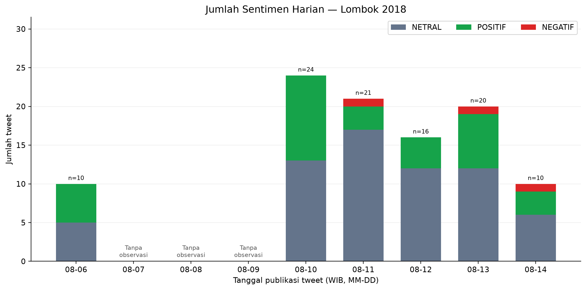
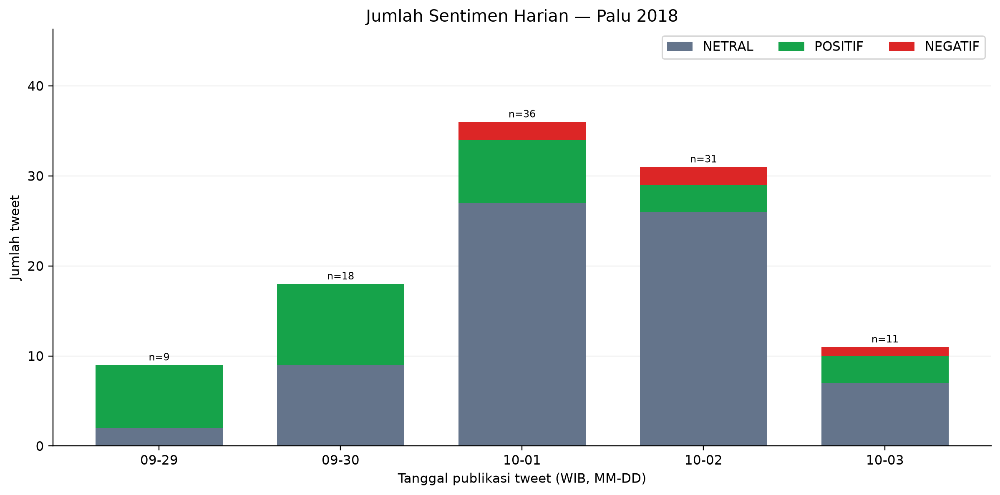
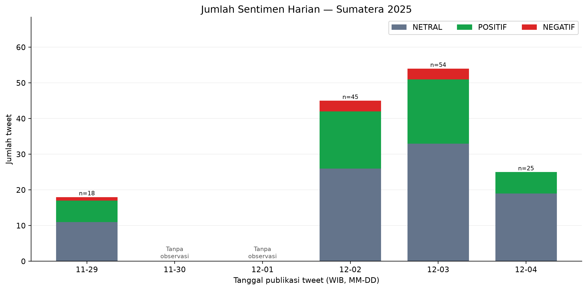
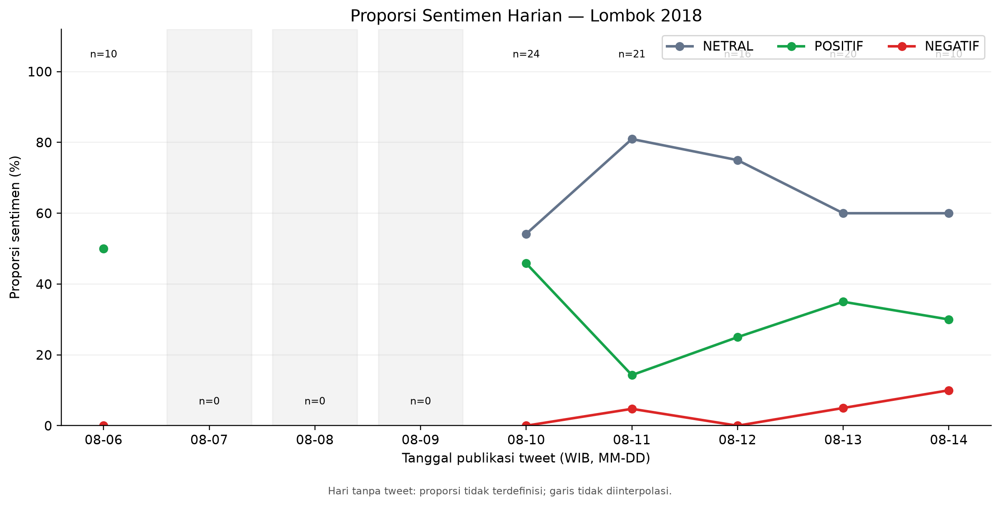
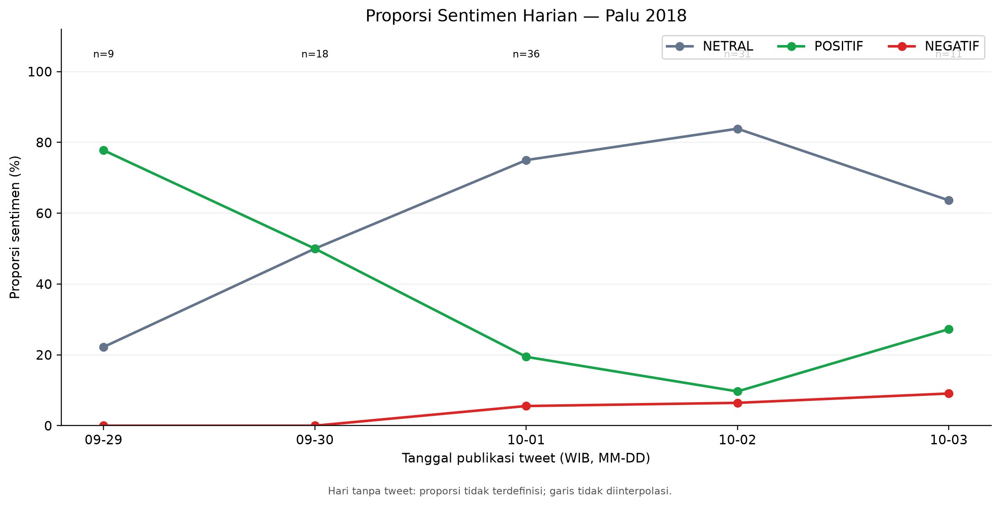
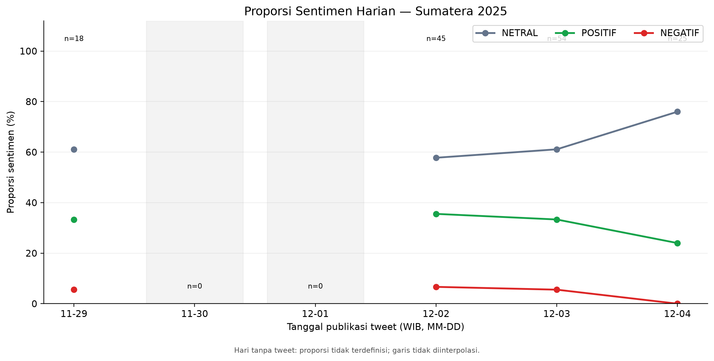
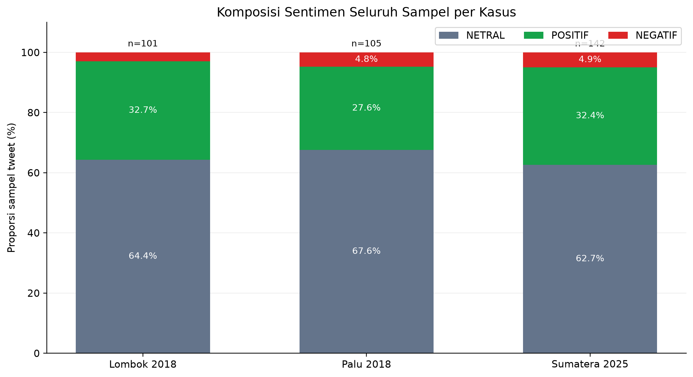

# BAB IV — HASIL PENELITIAN DAN PEMBAHASAN

**Penelitian:** Sentimen Penetapan Bencana Nasional

**Status:** PROVISIONAL — Menunggu penyelarasan pembimbing.

**Tahap:** 06_Result Part5

**Dibuat (UTC):** 2026-10-18T17:15:18.282469+00:00

> Dokumen ini mengintegrasikan hasil penelitian yang
> sudah dikunci. Empat isu metodologis masih terbuka.
> Belum merupakan BAB IV final yang disetujui.

## 4.1 Gambaran Umum Dataset

Penelitian menggunakan **348 tweet unik** yang telah
memiliki label sentimen manusia, mencakup tiga kasus
bencana: Lombok 2018, Palu 2018, dan Sumatera 2025.

### Tabel 4.1 Distribusi Dataset

| Kasus | Tweet | Netral | Positif | Negatif |
| --- | --- | --- | --- | --- |
| Lombok 2018 | 101 | 65 | 33 | 3 |
| Palu 2018 | 105 | 71 | 29 | 5 |
| Sumatera 2025 | 142 | 89 | 46 | 7 |

Secara keseluruhan, terdapat **225 tweet NETRAL**
(64.66%), **108 tweet POSITIF**
(31.03%), dan **15 tweet NEGATIF**
(4.31%).

Jumlah kelompok *leakage* unik pada dataset adalah 337.
Dominasi kelas NETRAL dan sedikitnya data NEGATIF
menjadi pertimbangan penting dalam evaluasi.

Hasil menggambarkan sampel yang terkumpul dan
tidak secara otomatis merepresentasikan seluruh
opini masyarakat.

## 4.2 Pengaturan Evaluasi Model

Penelitian mengimplementasikan model
**Long Short-Term Memory (LSTM)** untuk klasifikasi
sentimen tiga kelas.

Evaluasi menggunakan **Stratified Group K-Fold**
dengan tiga fold dan seed 123.
Prediksi *out-of-fold* digunakan untuk menghitung
metrik evaluasi pada 348 tweet.

TF-IDF + Logistic Regression digunakan sebagai
baseline pembanding tambahan.

Metrik utama yang digunakan adalah **OOF Macro-F1**,
agar ketiga kelas memperoleh bobot yang sama.

Tidak digunakan *independent holdout test set*.
Seluruh hasil evaluasi perlu ditafsirkan sesuai
dengan rancangan cross-validation tersebut.

**Catatan:** keberadaan baseline belum selaras
dengan batasan metode dalam proposal awal
dan memerlukan konfirmasi pembimbing.

## 4.3 Hasil Pemodelan Sentimen

### Tabel 4.2 Perbandingan Kinerja Model

| Model | Accuracy | Macro-Precision | Macro-Recall | Macro-F1 | Weighted-F1 |
| --- | --- | --- | --- | --- | --- |
| baseline | 0.7040 | 0.7761 | 0.4943 | 0.5236 | 0.6898 |
| lstm | 0.5862 | 0.4760 | 0.5596 | 0.4751 | 0.6175 |

Model LSTM menghasilkan accuracy
**58.62%**
dengan Macro-F1 **0.4751**.

Baseline menghasilkan accuracy
**70.40%**
dan Macro-F1 **0.5236**.

Perbedaan Macro-F1 adalah
**0.0484 poin**
dengan baseline memiliki nilai lebih tinggi.

Namun, Macro-Recall LSTM
(**0.5596**) lebih tinggi daripada
baseline (**0.4943**).
Hasil ini menunjukkan perbedaan karakteristik
evaluasi kedua model, bukan keunggulan LSTM
di seluruh metrik.

### Gambar 4.1

**Gambar 4.1. Perbandingan metrik evaluasi out-of-fold antara baseline TF-IDF + Logistic Regression dan LSTM.**

*Catatan interpretasi:* Baseline unggul pada OOF Macro-F1. LSTM memiliki Macro-Recall lebih tinggi.

*Sumber:* `04_Modeling/outputs/lstm_visualizations/05_baseline_vs_lstm_overall_metrics.png`

### Gambar 4.2

**Gambar 4.2. Matriks kebingungan prediksi out-of-fold model LSTM pada tiga kelas sentimen.**

*Catatan interpretasi:* Gunakan untuk membahas prediksi benar dan kesalahan antar kelas; bukan hasil independent test set.

*Sumber:* `04_Modeling/outputs/lstm_visualizations/04_confusion_matrix_lstm.png`

### Gambar 4.3

**Gambar 4.3. Perbandingan F1-score per kelas sentimen antara baseline dan LSTM berdasarkan prediksi OOF.**

*Catatan interpretasi:* Kelas NEGATIF memiliki support hanya 15 tweet; interpretasikan metrik kelas minoritas secara hati-hati.

*Sumber:* `04_Modeling/outputs/lstm_visualizations/06_per_class_f1_baseline_vs_lstm.png`

## 4.4 Analisis Kesalahan Klasifikasi

### Tabel 4.3 Evaluasi per Kelas

| Model | Sentimen | Support | TP | FP | FN | Precision | Recall | F1 |
| --- | --- | --- | --- | --- | --- | --- | --- | --- |
| baseline | NETRAL | 225 | 187 | 62 | 38 | 0.7510 | 0.8311 | 0.7890 |
| baseline | POSITIF | 108 | 56 | 41 | 52 | 0.5773 | 0.5185 | 0.5463 |
| baseline | NEGATIF | 15 | 2 | 0 | 13 | 1.0000 | 0.1333 | 0.2353 |
| lstm | NETRAL | 225 | 139 | 36 | 86 | 0.7943 | 0.6178 | 0.6950 |
| lstm | POSITIF | 108 | 57 | 58 | 51 | 0.4957 | 0.5278 | 0.5112 |
| lstm | NEGATIF | 15 | 8 | 50 | 7 | 0.1379 | 0.5333 | 0.2192 |

Kelas NEGATIF hanya terdiri atas 15 tweet aktual.
Baseline mengenali
**2**
tweet NEGATIF dan melewatkan
**13**.

LSTM mengenali
**8**
tweet NEGATIF, tetapi menghasilkan
**50**
*false positive* NEGATIF.

Recall NEGATIF LSTM adalah
**53.33%**,
sedangkan precision hanya
**13.79%**.

Artinya, LSTM lebih banyak menangkap contoh
NEGATIF yang sebenarnya, tetapi juga lebih sering
memberikan label NEGATIF kepada tweet yang bukan
anggota kelas tersebut.

Perbedaan tersebut perlu dibahas sebagai
*trade-off* precision dan recall.

Berdasarkan perbandingan prediksi berpasangan,
kedua model benar pada 165 tweet,
hanya baseline benar pada 80 tweet,
hanya LSTM benar pada 39 tweet,
dan keduanya salah pada 64 tweet.

Angka ini tidak digunakan untuk menyatakan
signifikansi statistik tanpa uji tambahan.

## 4.5 Distribusi Sentimen dan Analisis Temporal

Analisis temporal menggunakan **label manusia**
dan timestamp tweet yang dikonversi ke WIB.
Analisis ini **tidak menggunakan hasil prediksi LSTM**
sebagai sumber label timeline.

### Tabel 4.4 Cakupan Observasi

| Kasus | Tweet | Hari kalender | Hari observasi | Hari kosong | Tanggal puncak (WIB) | Tweet puncak |
| --- | --- | --- | --- | --- | --- | --- |
| Lombok 2018 | 101 | 9 | 6 | 3 | 2018-08-10 | 24 |
| Palu 2018 | 105 | 5 | 5 | 0 | 2018-10-01 | 36 |
| Sumatera 2025 | 142 | 6 | 4 | 2 | 2025-12-03 | 54 |

Total terdapat **20 hari kalender kasus**,
yaitu 15 hari dengan observasi dan lima hari
tanpa tweet dalam sampel.

Puncak harian Lombok terjadi pada
2018-08-10 dengan 24 tweet;
Palu pada 2018-10-01 dengan 36 tweet;
dan Sumatera pada 2025-12-03 dengan 54 tweet.

Periode observasi masing-masing kasus berbeda.
Oleh karena itu, volume antarkasus tidak dapat
langsung diartikan sebagai perbedaan tingkat
perhatian publik.

### 4.5.1 Jumlah Tweet Harian

### Gambar 4.4

**Gambar 4.4. Jumlah tweet menurut kelas sentimen per hari untuk kasus Lombok 2018 (WIB).**

*Catatan interpretasi:* Tiga tanggal tanpa observasi memiliki jumlah nol; bukan bukti ketiadaan diskusi publik.

*Sumber:* `05_Temporal/outputs/timeline_visualizations/01_lombok_daily_counts.png`

### Gambar 4.5

**Gambar 4.5. Jumlah tweet menurut kelas sentimen per hari untuk kasus Palu 2018 (WIB).**

*Catatan interpretasi:* Seluruh lima hari kalender memiliki observasi dalam sampel penelitian.

*Sumber:* `05_Temporal/outputs/timeline_visualizations/02_palu_daily_counts.png`

### Gambar 4.6

**Gambar 4.6. Jumlah tweet menurut kelas sentimen per hari untuk kasus Sumatera 2025 (WIB).**

*Catatan interpretasi:* Dua hari kalender tanpa observasi dipertahankan di dalam grafik.

*Sumber:* `05_Temporal/outputs/timeline_visualizations/03_sumatra_daily_counts.png`

### 4.5.2 Proporsi Sentimen Harian

### Gambar 4.7

**Gambar 4.7. Persentase label sentimen harian pada sampel tweet Lombok 2018 beserta ukuran sampel harian.**

*Catatan interpretasi:* Tanggal tanpa tweet memiliki persentase tidak terdefinisi dan tidak diinterpolasi.

*Sumber:* `05_Temporal/outputs/timeline_visualizations/04_lombok_daily_percentage.png`

### Gambar 4.8

**Gambar 4.8. Persentase label sentimen harian pada sampel tweet Palu 2018 beserta ukuran sampel harian.**

*Catatan interpretasi:* Perhatikan nilai n saat membandingkan perubahan persentase antartanggal.

*Sumber:* `05_Temporal/outputs/timeline_visualizations/05_palu_daily_percentage.png`

### Gambar 4.9

**Gambar 4.9. Persentase label sentimen harian pada sampel tweet Sumatera 2025 beserta ukuran sampel harian.**

*Catatan interpretasi:* Hari tanpa observasi tidak ditampilkan sebagai persentase nol.

*Sumber:* `05_Temporal/outputs/timeline_visualizations/06_sumatra_daily_percentage.png`

Persentase pada hari tanpa observasi
bersifat tidak terdefinisi, bukan nol.
Pembacaan proporsi harian perlu mempertimbangkan
jumlah tweet yang tersedia pada tanggal tersebut.

## 4.6 Perbandingan Sentimen Antarkasus

### Tabel 4.5 Komposisi Sentimen per Kasus

| Kasus | Netral (%) | Positif (%) | Negatif (%) |
| --- | --- | --- | --- |
| Lombok 2018 | 64.3564 | 32.6733 | 2.9703 |
| Palu 2018 | 67.6190 | 27.6190 | 4.7619 |
| Sumatera 2025 | 62.6761 | 32.3944 | 4.9296 |

NETRAL merupakan kategori terbesar
pada ketiga kasus.

Persentase NETRAL masing-masing kasus adalah:
Lombok **64.36%**,
Palu **67.62%**,
dan Sumatera **62.68%**.

Perbedaan komposisi ini merupakan temuan
deskriptif atas tweet yang dianotasi,
bukan bukti pengaruh kausal keputusan kebijakan.

### Gambar 4.10

**Gambar 4.10. Komposisi label sentimen manusia pada sampel tweet Lombok 2018, Palu 2018, dan Sumatera 2025.**

*Catatan interpretasi:* Menunjukkan proporsi sampel; bukan estimasi representatif opini masyarakat.

*Sumber:* `05_Temporal/outputs/timeline_visualizations/08_sentiment_composition_by_case.png`

## 4.7 Kesesuaian dengan Rumusan Masalah

### RM1 — Penerapan LSTM

RM1 dijawab melalui implementasi LSTM dan evaluasi
OOF pada tiga kategori sentimen.
Kinerja yang diperoleh mencakup accuracy,
Macro-F1, dan metrik per kelas.

### RM2 — Hasil Klasifikasi Tiga Kelas

RM2 didukung oleh hasil klasifikasi LSTM,
confusion matrix, serta pengukuran precision,
recall, dan F1 pada NETRAL, POSITIF, dan NEGATIF.

Keterbatasan paling menonjol terjadi pada
kelas NEGATIF yang memiliki 15 tweet aktual.

### RM3 — Dinamika Temporal Sentimen

RM3 dijawab secara **deskriptif** melalui distribusi
label manusia per tanggal pada tiga kasus.

Hasil ini belum dapat disebut sebagai
dinamika sentimen yang *diprediksi oleh LSTM*.

Perlu konfirmasi apakah analisis berbasis label
manusia sudah sesuai ruang lingkup yang disetujui
atau membutuhkan evaluasi temporal model tambahan.

## 4.8 Keterbatasan dan Isu Metodologis

Analisis memiliki beberapa keterbatasan:
ukuran sampel 348 tweet, distribusi label timpang,
tidak adanya independent holdout test set,
serta perbedaan jendela observasi antarkasus.

Empat isu metodologis dari Part4 tetap terbuka:

### METHOD_01 — Baseline comparison outside proposal boundary

**Prioritas:** HIGH

**Masalah:** TF-IDF + Logistic Regression benchmark is evaluated alongside LSTM.

**Tindakan:** Seek supervisor approval to revise the methodological boundary or explicitly document the benchmark as an added evaluation.

**Status:** Belum terselesaikan.

### METHOD_02 — Temporal labels versus LSTM predictions

**Prioritas:** HIGH

**Masalah:** Temporal timeline currently aggregates locked human sentiment labels.

**Tindakan:** Explicitly distinguish annotation-based temporal analysis from model-based classification; confirm intended scope with supervisor.

**Status:** Belum terselesaikan.

### METHOD_03 — Policy terminology and causal interpretation

**Prioritas:** MEDIUM

**Masalah:** Observed tweet labels do not establish effects of a particular policy decision.

**Tindakan:** Standardize operational definitions and avoid causal/policy-impact claims.

**Status:** Belum terselesaikan.

### METHOD_04 — Sample coverage and test design

**Prioritas:** MEDIUM

**Masalah:** 348 collected tweets, 15 NEGATIF, 3-fold OOF without independent holdout.

**Tindakan:** Report class imbalance, sampling limits and OOF generalization uncertainty.

**Status:** Belum terselesaikan.

## 4.9 Ringkasan Hasil Penelitian

Berdasarkan evaluasi OOF, baseline memiliki
Macro-F1 lebih tinggi daripada LSTM, sedangkan
LSTM memiliki Macro-Recall lebih tinggi.

Analisis kesalahan menunjukkan tantangan
identifikasi kelas NEGATIF karena data aktual
yang terbatas serta perbedaan precision dan recall.

Pada analisis temporal berbasis label manusia,
NETRAL mendominasi sampel pada tiga kasus,
dengan variasi distribusi dan cakupan waktu.

Seluruh kesimpulan berlaku pada dataset penelitian.
Tidak dilakukan inferensi populasi maupun
penarikan kesimpulan kausal atas kebijakan.

**Status dokumen: PROVISIONAL.**

**Empat isu metodologis terbuka: 4.**

**Persetujuan pembimbing: BELUM TERKONFIRMASI.**

## Catatan Provenance

- Dataset dan metrik telah diaudit pada Part1–Part2.
- Gambar merupakan PNG asli yang dikunci pada Part3.
- Rumusan masalah dipetakan dalam Part4.
- Semua nomor gambar pada Part5 mengikuti urutan
  subbab dan masih dapat disesuaikan dengan
  pedoman penulisan akhir.
- Tidak ada model yang dilatih ulang dalam Part5.
