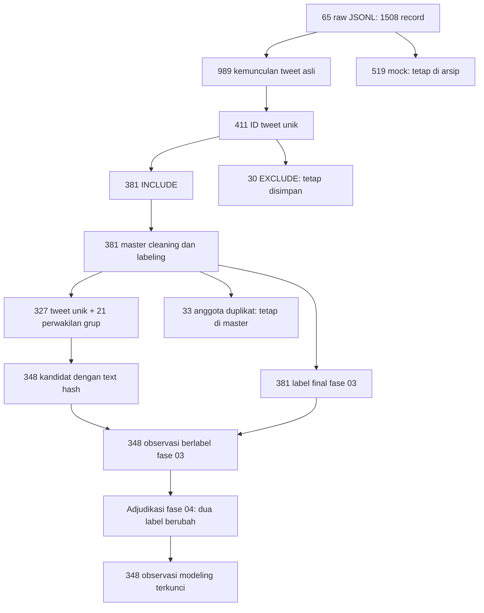

# Documentation Part2 — Provenance dan data lineage fase 01–03

Status: **awal dokumentasi berbasis artefak tersimpan; PROVISIONAL**. Baseline Git: `09391e6c5777a8c34edd8482a8bf3e2859f64408`. Tidak ada scraping, training, labeling ulang, atau eksekusi cell penelitian.

## Aliran dan titik keputusan

Jumlah, ID, dan teks diperiksa dari file, bukan diambil dari nama file atau target scraping. Rincian hubungan beserta notebook/cell pembentuk ada di [lineage_edges.csv](lineage_edges.csv); ringkasan terstruktur ada di [lineage_summary.json](lineage_summary.json).

## 01_Raw Data — pengumpulan dan review relevansi

`full_scraping_raw_data.ipynb`, cell 5, mendefinisikan kasus, periode inklusif dalam WIB dan kombinasi EVENT/POLICY. Cell 7–9 merencanakan task dan memvalidasi query. Ini menjelaskan rancangan; jumlah task rencana bukan jumlah task yang benar-benar tersimpan.

`outputs/reports/batch7/final_collection/raw_inventory_current.csv` menunjuk **65** file JSONL tersimpan. Pembacaan langsung seluruh file memverifikasi **1.508** record: **989** bertipe `tweet`, **519** `mock_tweet`; terdapat **411** ID tweet asli unik. Pengulangan kemunculan ID tidak dihitung sebagai observasi baru. Raw dan mock tetap disimpan sebagai bukti pengumpulan. Hash agregat raw historis dapat direkonstruksi dari task ID terurut dan SHA masing-masing file dalam representasi akhir baris aslinya.

Cell 21/33 menyediakan scan dan laporan master; cell 41–42 memeriksa dan menyimpan snapshot koleksi; cell 43–46 mempersiapkan dan merekonsiliasi review. `master_tweets_current.csv` merekam `task_id`, `run_id`, `raw_path` dan `raw_line_number`. `Batch7_Reconciliation_Summary.json`, eligible, dan excluded CSV membentuk partisi lengkap: **381 INCLUDE + 30 EXCLUDE = 411**. Semua ID unik dan kedua bagian tidak beririsan. Keputusan relevansi ini berbeda dari label sentimen.

## 02_Cleaning — teks dan pemilihan perwakilan

`02_text_cleaning.ipynb` cell 1 membaca `Batch7_Eligible_Tweets.csv`. Cell 3 menghasilkan `clean_df`; cell 4 menghasilkan `social_df`; cell 5–6 menyiapkan dan merekonsiliasi review semantik; cell 7 menghasilkan `ling_df`. Ketiganya sempat berstatus AST_REVIEW di preflight, tetapi sumber aslinya valid. Cell tersebut merupakan jalur pembentukan teks, sehingga dipertahankan.

Cell 8 mengaudit teks identik per kasus. ID grup dibentuk dari 16 digit heksadesimal awal SHA-256 UTF-8 atas `case + NUL + text_linguistic`. Cell 9–10 memakai review untuk memilih satu perwakilan setiap grup, serta mempertahankan teks panjang penuh. Master `part8_content_reconciled.csv` tetap **381** baris: **327 SELECTED_UNIQUE**, **21 SELECTED_REPRESENTATIVE**, **33 GROUP_MEMBER_NOT_SELECTED**. Jadi 348 adalah 327 + 21, bukan hasil menghapus 33 baris dari master.

Cell 11 mengirim `labeling_all_381.csv` dan `labeling_candidates_348.csv`. `final_text_hash` adalah SHA-256 UTF-8 dari string `text_linguistic` persis sebagaimana tersimpan. Input labeling masih memiliki label kosong. Field seleksi, teks, hash, dan ID dari 348 kandidat diteruskan tanpa perubahan ke handoff final.

## 03_Labeling — codebook, review dan handoff

`03_sentiment_labeling.ipynb` cell 4–8 mendokumentasikan pilot 30, validasi, adjudikasi, dan kalibrasi codebook v1.1. Cell 9 menyiapkan workbook 381; cell 10 adalah diagnosis status; cell 11 mengaudit progres; cell 12–14 menyiapkan dan merekonsiliasi konflik label duplikat; cell 15 memvalidasi handoff.

`duplicate_reconciliation.json` dan `duplicate_label_changelog.csv` merekam **4 baris dalam 2 grup** yang ditinjau, **2 label berubah**, dan tidak ada konflik grup tersisa. `labeled_final_381.csv` mempertahankan seluruh 381 ID. `modeling_labeled_348.csv` memilih ID kandidat semula dan mengambil label final berdasarkan ID. Semua 348 label cocok dengan master final 381; teks, case dan hash tetap sama.

| Versi label | NETRAL | POSITIF | NEGATIF | Total |
|---|---:|---:|---:|---:|
| Master final fase 03 | 253 | 113 | 15 | 381 |
| Handoff fase 03 | 223 | 110 | 15 | 348 |
| Dataset terkunci fase 04 | 225 | 108 | 15 | 348 |

Handoff fase 03 memiliki **101 Lombok, 105 Palu, 142 Sumatra**. Jumlah dan ID ini tetap sama pada fase 04.

## Jembatan ke dataset modeling terkunci

Penyebutan “final 348” harus menyertakan versi labelnya. Pada `04_modeling.ipynb` cell 5–6, adjudikasi near-duplicate berikutnya mengubah label **POSITIF → NETRAL** untuk ID `1027914286184550402` dan `1046787140594618373`. Ini berbeda dari adjudikasi duplikat pada fase 03. Changelog, rekonsiliasi, dataset adjudicated, dan dataset grouped sama-sama diperiksa. Cell 8 menambahkan leakage grouping; teks dan ID tidak berubah. Manifest split final mencatat **337 leakage groups**, bukan 337 observasi.

Dataset modeling sumber terkunci adalah `04_Modeling/outputs/leakage_grouping/modeling_labeled_348_grouped.csv`; hash historisnya `cfa7df27079ef47bdb1b0cb526bc017aa1c8fe18dc4d91fef870a3441e2e9fb7` merujuk representasi CSV Windows. SHA byte Git yang benar-benar diperiksa tersedia terpisah di source manifest. Label fase 03 tidak ditimpa agar kedua keputusan tetap dapat ditelusuri.

## Bukti per observasi dan SHA

[observation_lineage_348.csv](observation_lineage_348.csv) berisi 348 ID string, raw path dan SHA byte Git, task/run ID, nomor baris raw, nomor record di setiap handoff, ID grup, hash teks, label fase 03/04, dan sumber anotasi yang tercatat. Nomor **record CSV tidak termasuk header** dan bukan nomor baris fisik ketika teks mengandung newline. Nomor JSONL adalah baris fisik satu-based. Untuk setiap observasi, raw record, ID, case, teks asli, teks akhir dan hash telah dicocokkan.

[source_manifest.csv](source_manifest.csv) memetakan sumber ke commit, Git blob OID dan SHA-256 byte Git. [historical_sha_checks.csv](../notebook_cleanup_decisions/historical_sha_checks.csv) menyimpan SHA yang dilaporkan audit lama dan hasil pemeriksaan. Git menormalisasi akhir baris beberapa file Windows: `CRLF_RECONSTRUCTION_ONLY` serta `CSV_RECORD_CRLF_RECONSTRUCTION_ONLY` berarti hash lama cocok hanya setelah rekonstruksi di memori; status tersebut **bukan** `EXACT_BYTES`. Tidak ada file sumber yang dinormalisasi atau ditulis ulang.

Inventaris historis 455 file seluruhnya cocok secara byte atau melalui rekonstruksi akhir baris yang dijelaskan. Notebook dokumentasi dalam preflight memiliki perbedaan hash file penuh karena snapshotnya diambil sebelum hasil preflight disimpan. Hash snapshot lama berhasil direkonstruksi persis di memori dengan mengosongkan output dan mengembalikan execution count cell kedua ke null pada versi baseline, tanpa mengubah source atau file. Semua 238 sumber cell, termasuk dua cell dokumentasi, cocok persis dengan inventaris. Snapshot yang dicatat tidak diganti dengan hash baru.

## Batas bukti yang tetap terbuka

Artefak hybrid mencatat 130 manual locked dan 251 AI pending, tetapi `ai_predictions_251.csv` yang tersedia hanya memiliki **10 baris**. Nilai `annotation_source` final adalah `FULL_MANUAL`/`PILOT_ADJUDICATED`; nilai ini tidak membuktikan apakah saran AI diterima, ditolak, atau ditinjau untuk setiap baris. Log prediksi lengkap dan penerimaan/review tidak tersedia dalam bukti yang diperiksa. Part2 tidak menyatakan 251 prediksi selesai, tidak menyimpulkan seluruh label dibuat manual, dan tidak mengarang hubungan producer notebook untuk proses hybrid yang tidak tercatat di source notebook.

Empat isu metodologis pada `06_Result/outputs/integrated_report/open_methodological_issues.json` tetap terbuka. Temporal menggunakan label anotasi terkunci, bukan otomatis prediksi LSTM. Data merupakan sampel hasil koleksi dan review, bukan bukti populasi atau efek kausal kebijakan. Laporan tetap PROVISIONAL; persetujuan pembimbing dan review visual PDF tidak dinyatakan selesai.

Panduan sampling/anotasi: [sampling_and_labeling.md](sampling_and_labeling.md). Kamus data: [data_dictionary.csv](data_dictionary.csv). Pemeriksaan lokal: `python 07_Documentation/scripts/verify_cleanup_lineage.py` dari repository dengan commit baseline tersedia; hanya Python standar dan Git yang diperlukan. Ini memverifikasi bukti tersimpan, bukan mereproduksi proses scraping atau training.
